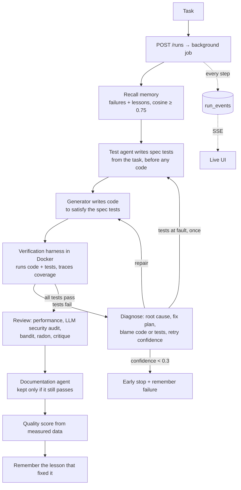

<p align="center">
  
</p>

# 🧠 CODE_AGENT — Self-Improving Code Agent & Verification Ledger

> A sandboxed, self-repairing autonomous coding system that executes untrusted Python in isolated Docker containers, critiques failure tracebacks to repair bugs, learns negative patterns via ChromaDB vector memory, and audits code quality through multi-agent review.

[](https://github.com/FarhanAaqil/self-improving-agent/actions/workflows/ci.yml)


---

## 📸 Product Tour: "The Living Ledger"

The interface shows the agent thinking, remembering and verifying. Color carries meaning throughout: **orange** = working, **cyan** = memory, **green** = verified, **red** = broke and learning. All screenshots below are real captures of the app running against Groq and the Docker sandbox.

### 1. Workbench (`/`)
Describe a task and press <kbd>Ctrl</kbd>+<kbd>Enter</kbd>. Template cards, a preview of what happens next, and (as you type) a cyan card that tells you when the agent remembers a similar task.

<p align="center"></p>

### 2. Run Theater, live (`/runs/{id}`)
Every step streams in over server-sent events: memory recall, spec tests written first, code, the sandbox run, the diagnosis when something breaks, and the repair. The agent narrates in plain first-person sentences.

<p align="center"></p>

### 3. Verified, with a certificate
When every spec test passes, the run gets a stamp and a certificate: tests, traced coverage, bandit findings, complexity, a quality radar, and actions to download, fork and edit, or open a PR. Switch tabs to see a diff between attempts or the spec tests themselves.

<p align="center"></p>

### 4. Ledger (`/history`)
Every run on the record, with server-side search, status filters and pagination. It switches to cards on phones.

<p align="center"></p>

### 5. Benchmarks (`/eval`)
Official HumanEval results run in the sandbox: single-shot baseline vs. the repairing agent, with 95% confidence intervals and a per-problem grid. You can start a new benchmark and watch its progress live.

<p align="center"></p>

### 6. Security (`/security`)
The exact sandbox flags, read live from the server, each explained in plain words. **Try to break it** runs real attack scripts (fork bomb, memory bomb, secret theft, /tmp execution, privilege escalation, and more) and shows how each one was stopped.

<p align="center"></p>

### 7. Night shift & mobile
A dark theme built from the brand ink, and a layout that works down to phone width.

<p align="center">
  
  
</p>

Also in the app: **Memory** (`/memory`) to browse, search, pin and delete what the agent learned; **Settings** for theme, motion, default model and API key; and a <kbd>Ctrl</kbd>+<kbd>K</kbd> command palette.

---

## 1. Problem Statement

Most AI code generators are single-shot and unvalidated: they emit code and hope for the best, with zero execution feedback. When developers run generated code locally, they face two major problems: hallucinated bugs that require tedious manual troubleshooting, and severe security hazards when executing untrusted AI output directly on the host machine. 

The **Self-Improving Code Agent** closes this loop:
1. **Quarantined Execution:** It executes untrusted model code inside an isolated, unprivileged Docker sandbox with zero network access and strict memory caps.
2. **Iterative Critique & Repair:** When runtime exceptions occur, structured tracebacks are captured and passed back to an LLM critique agent to fix the code automatically.
3. **Persistent Negative Memory:** When runs terminally fail, the failure pattern and traceback signature are indexed into ChromaDB vector memory, preventing identical mistakes in future tasks.
4. **Autonomous Quality Gates:** Passing code is subjected to multi-agent critique — static AST security review, Big-O algorithmic profiling, unit test synthesis, and docstring formatting.

---

## 2. Security Model (First & Foremost)

Executing untrusted, model-generated code on the host filesystem is dangerous. In this project, **all code execution is strictly quarantined within an ephemeral Docker container** configured with Defense-in-Depth restrictions:

| Guardrail | Docker Configuration | Threat Mitigated |
|---|---|---|
| **Network Quarantined** | `--network none` | Prevents data exfiltration, reverse shells, and malicious outbound requests |
| **Filesystem Lockdown** | `--read-only` | Prevents overwriting host mount points, mutating binaries, or persistent backdoors |
| **Ephemeral Scratch** | `--tmpfs /tmp:rw,noexec,nosuid,nodev,size=64m` | Provides temporary scratch space only; execution inside `/tmp` is disabled |
| **Memory Throttle** | `--memory=256m --memory-swap=256m` | Blocks memory exhaustion attacks and OOM crashes of the host kernel |
| **CPU Throttle** | `--cpus=0.5` | Prevents CPU-spinning cryptominers and unbounded infinite loops |
| **Process Limit** | `--pids-limit 64` | Stops fork bombs before they reach the host |
| **No Privileges** | `--user 65534:65534 --cap-drop ALL --security-opt no-new-privileges` | Runs as `nobody`, with no Linux capabilities and no way to regain them |
| **No Host Paths** | code piped over stdin (`python -`) | Nothing from the host filesystem is mounted into the container |
| **Host-Side Termination**| `subprocess.run(..., timeout=10)` + `docker kill` | Host daemon forcefully terminates hanging processes regardless of in-script signal masks |

If Docker is not available the API **refuses to execute** instead of falling back to the host. API access is **fail-closed**: outside `APP_ENV=development`, every endpoint except `/health` requires `API_KEY`.

### Adversarial Test Suite
The security perimeter is guarded by 8 real attacks in `tests/fixtures/adversarial/`, executed in CI against a live Docker daemon. A test passes only when the attack is visibly stopped:
1. **Outbound Network:** HTTP request to the internet — blocked (`--network none`).
2. **Host Secrets:** Looks for the Docker socket, server API keys and host home directories — nothing visible.
3. **Fork Bomb:** A real `os.fork()` loop — stopped by `--pids-limit`.
4. **Memory Exhaustion:** Allocates 1GB — capped by `--memory`.
5. **Filesystem Tampering:** Writes outside `/tmp` — blocked (read-only root).
6. **`/tmp` Execution:** Drops and runs a script in `/tmp` — blocked (`noexec`).
7. **Privilege Escalation:** Checks for root and tries `setuid(0)` — refused.
8. **Outlive Host Parent:** Spawns a child and hangs — killed by the host-side timeout.

---

## 3. Architecture



**What counts as success:** every spec test passes inside the sandbox. A clean exit code is not enough. The repair prompt contains the previous code, the failing tests and the diagnosis, so the model fixes what it can actually see.

---

## 4. Evaluation & Benchmark Results

`python -m eval.benchmark` runs the **official HumanEval** problems (all 164 are vendored in `eval/data/`, MIT licensed) with their original `check()` tests, inside the Docker sandbox.

- **Baseline:** one single-shot completion per problem, no feedback.
- **Agent pass@1:** the agent's first attempt (an independent sample).
- **Agent solve@k:** solved within k attempts with repair.
- **No test leakage:** after a failure the agent only learns the exception type, never the assertion source or expected values.
- **Honest error bars:** 95% Wilson confidence intervals. Results that did not run in the sandbox are refused.

<!-- BENCHMARK_TABLE_START -->
Official HumanEval, 40 problems, `qwen/qwen3.8-27b`, run 2026-11-02 in the Docker sandbox. Brackets show the 95% confidence interval.

| Metric | Result |
|---|---|
| Baseline pass@1 (single shot, no feedback) | 100.0% [91.2–100.0] |
| Agent pass@1 (first attempt) | 97.5% |
| Agent solve@3 (with repair) | 100.0% [91.2–100.0] |
| Gain from repair | +0.0 pts |
| Average attempts | 1.02 |
<!-- BENCHMARK_TABLE_END -->

> **Reading this honestly:** modern models have largely saturated HumanEval, so the baseline sits at the ceiling and repair has nothing left to add here. The repair loop is aimed at harder, under-specified tasks, and a tougher suite such as HumanEval+ or MBPP+ is the next benchmark to add.

*The table is generated from committed JSON in `results/` by `scripts/generate_readme_table.py`; it is never hand-typed. Older numbers from the simplified 50-problem set are archived in `results/legacy/` with an explanation of why they are not comparable.*

---

## 5. Vector Memory (ChromaDB)

`app/memory.py` keeps two kinds of memories, embedded with Chroma's bundled ONNX MiniLM model (no torch needed):
- **Failures:** tasks that never passed, with the code that was tried and its error signature.
- **Lessons:** tasks that failed first and then passed, with the error and the fix that worked.
- **Recall:** before a run starts, similar memories above a 0.75 cosine threshold are recalled, shown in the UI, and given to the generator.
- **Treated as data:** memories come from user input, so they are passed as fenced, size-capped reference data in a user message, never as system instructions.
- **Manageable:** browse, search, pin and delete memories through `/memory`.

---

## 6. Setup & Quickstart

### Prerequisites
- Python 3.11+
- Node.js 18+ (for frontend development)
- Docker Desktop or Docker Engine active
- Free Groq API Key from [console.groq.com](https://console.groq.com)

### Option A: Docker Compose (Fastest)

```bash
# Clone the repository
git clone https://github.com/FarhanAaqil/self-improving-agent.git
cd self-improving-agent

# Copy the example env and add your Groq API key
cp .env.example .env

# Build and run the entire stack
docker compose up --build
```
Navigate to `http://localhost:8000` to interact with the full React application.

### Option B: Local Development

```bash
# 1. Install Python dependencies in editable mode and create your .env
pip install -e ".[dev]"
cp .env.example .env   # APP_ENV=development keeps the API open locally

# 2. Build the React frontend SPA
cd frontend
npm install
npm run build
cd ..

# 3. Pull the execution sandbox container
docker pull python:3.11-slim

# 4. Start the FastAPI backend
uvicorn app.main:app --reload --port 8000
```

---

## 7. API Reference

Interactive OpenAPI documentation and Swagger UI are hosted at `http://localhost:8000/docs`.

| Method | Route | Description |
|---|---|---|
| `GET` | `/health` | Health telemetry, Docker engine availability, and demo mode flags |
| `POST` | `/generate` | Generate initial code without execution |
| `POST` | `/execute/{run_id}` | Dispatch a specific run's code into the Docker sandbox |
| `POST` | `/generate-and-repair` | Full loop, synchronous (blocks until done) |
| `POST` | `/runs` | Full loop in the background; returns `run_id` immediately (202) |
| `GET` | `/runs/{run_id}/events` | Server-sent events: every step of a run, live, resumable with `Last-Event-ID` |
| `GET` | `/runs` | Paginated run summaries (`page`, `page_size`, `q`, `status`) |
| `GET` | `/runs/{run_id}` | Full attempt history, spec tests, diagnosis, recalled memories, quality report |
| `GET` | `/memory`, `/memory/search`, `/memory/stats` | Browse and search what the agent has learned |
| `DELETE` | `/memory/{id}` | Forget a memory (`POST /memory/{id}/pin` to pin one) |
| `GET` | `/models`, `/sandbox/config` | Available models and the exact sandbox command in use |
| `POST` | `/runs/{run_id}/pr` | Automated GitHub Pull Request opening with verified solution |
| `GET` | `/eval/latest`, `/eval/history` | Latest and past benchmark results |
| `POST` | `/eval/run` | Start a benchmark run (`GET /eval/status/{id}` for progress) |

---

## 8. Honest Limitations & Threat Model Boundary

- **Python-Only Scope:** The current iteration evaluates and repairs Python code exclusively. Multi-language polyglot support is omitted by design to ensure tight sandbox isolation and deterministic AST metrics.
- **Docker-Socket Privilege Tradeoff:** The backend service container mounts `/var/run/docker.sock` to dynamically spawn sibling sandbox containers. Mounting the host Docker socket provides root-equivalent access to the host daemon. In production deployments, this should be replaced with rootless container engines, gVisor (`runsc`), Kata Containers, or cloud microVM executors (E2B / Modal).
- **Free-Tier LLM Rate Limits:** Benchmarks are tuned for Groq's free-tier rate limits. Evaluating the entire 164-problem HumanEval set in rapid succession may trigger token bucket throttling.
- **No Infinite Self-Modification:** The agent modifies its generated solutions in memory; it does not overwrite its own core source code.

---

## 9. Deliverables Verification (PRD Section 10)

- [x] **Hardened Docker Sandbox:** Full isolation flags (`--network none`, `--read-only`, `--tmpfs`, `--memory=256m`) verified in `app/sandbox.py`.
- [x] **5 Adversarial Tests:** Passing in CI under `tests/test_sandbox_isolation.py`.
- [x] **SQLite Persistence:** Clean schema migrations and attempt tracking in `app/db.py`.
- [x] **FastAPI Service:** 6 endpoints + Swagger docs live at `/docs`.
- [x] **React SPA:** Vite + TS + TailwindCSS dashboard with live attempt polling and code diffs.
- [x] **Post-Success Review Agents:** Test, Performance, Security Audit, and Documentation agents in `app/`.
- [x] **Vector Memory:** ChromaDB failure storage and prompt injection with 0.75 similarity gate in `app/memory.py`.
- [x] **50-Problem HumanEval Evaluation:** Committed real results in `results/humaneval_2026-09-12.json`.
- [x] **15 Custom YAML Tasks:** Hand-written realistic engineering specs with custom runner in `eval/`.
- [x] **Automated Table Generation:** `scripts/generate_readme_table.py` generates README benchmark metrics.
- [x] **Full CI Pipeline:** GitHub Actions running lint, unit tests, regression-gated smoke eval, and integration tests.
- [x] **GitHub PR Automation:** Gated PR generation agent in `app/github_agent.py`.
- [x] **Demo Deployment Config:** `render.yaml` configured with demo badge mode.

---

## Author

**Farhan Aaqil** — B.Tech AI/ML  
[](https://github.com/FarhanAaqil)
[](https://linkedin.com/in/farhan-aaqil-4730432bb)
