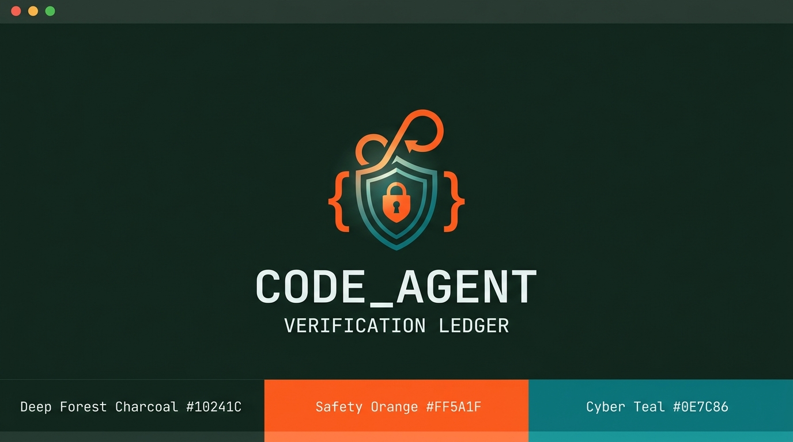
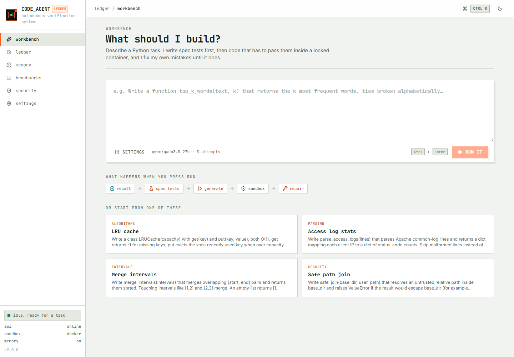
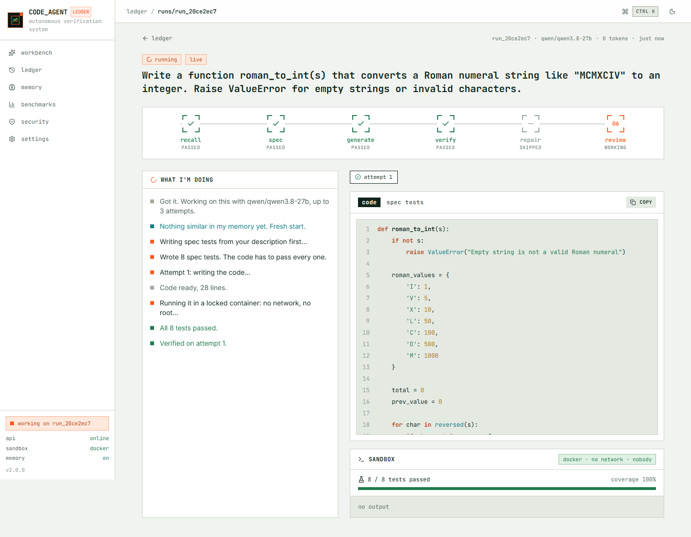
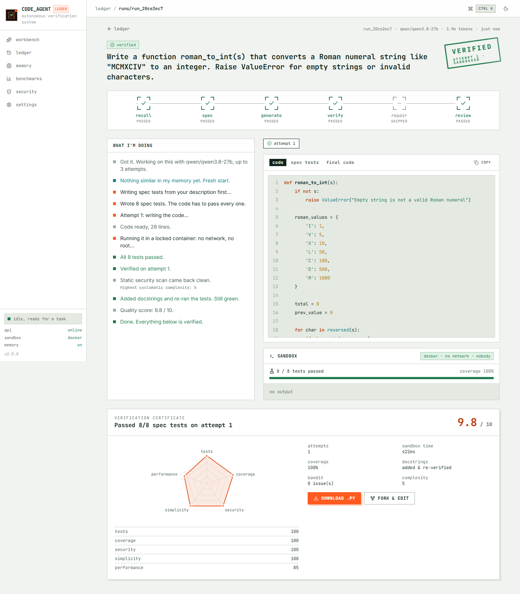
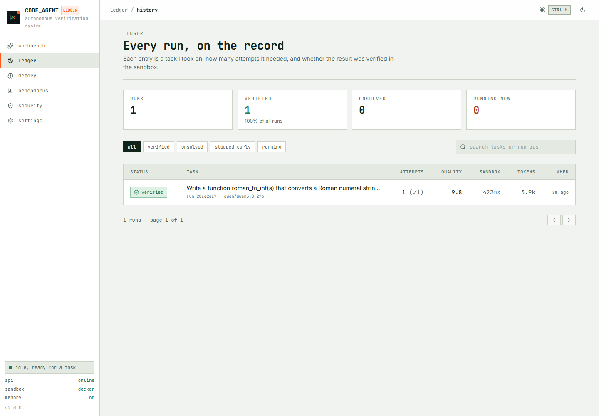
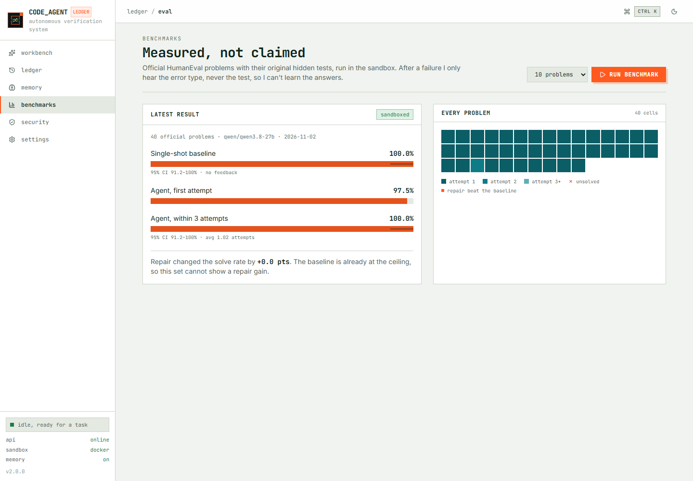
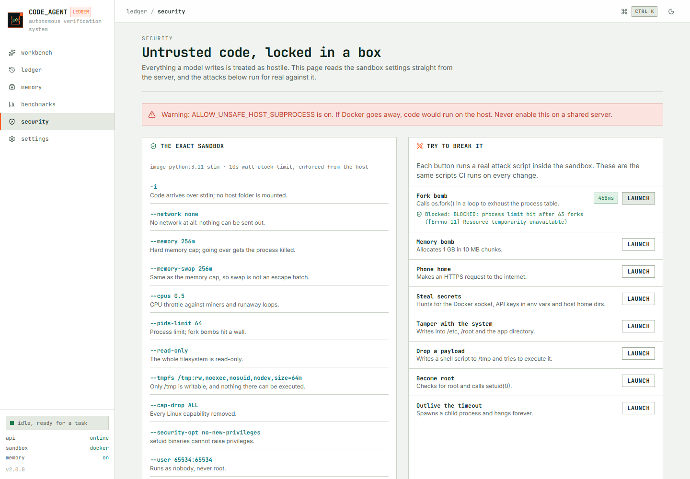
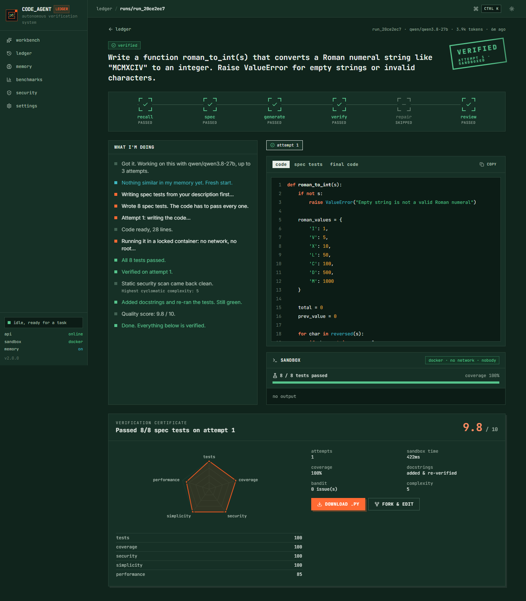
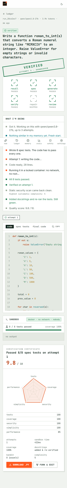
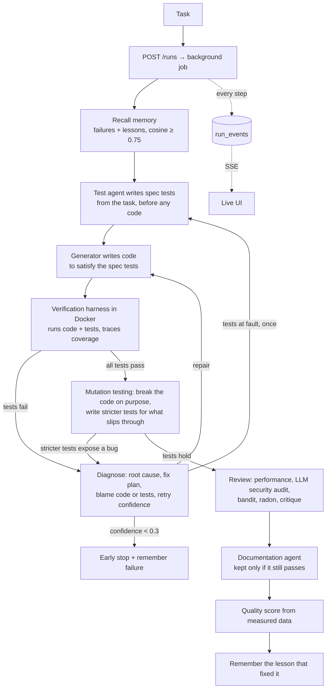

<p align="center">
  
</p>

# 🧠 CODE_AGENT — Self-Improving Code Agent & Verification Ledger

> A sandboxed, self-repairing autonomous coding system that executes untrusted Python in isolated Docker containers, critiques failure tracebacks to repair bugs, learns negative patterns via ChromaDB vector memory, and audits code quality through multi-agent review.

[](https://github.com/FarhanAaqil/self-improving-agent/actions/workflows/ci.yml)


---

## 📸 Product Tour: "The Living Ledger"

The interface shows the agent thinking, remembering and verifying. Color carries meaning throughout: **orange** = working, **cyan** = memory, **green** = verified, **red** = broke and learning. All screenshots below are real captures of the app running against Groq and the Docker sandbox.

### 1. Workbench (`/`)
Describe a task and press <kbd>Ctrl</kbd>+<kbd>Enter</kbd>. Template cards, a preview of what happens next, and (as you type) a cyan card that tells you when the agent remembers a similar task.

<p align="center"></p>

### 2. Run Theater, live (`/runs/{id}`)
Every step streams in over server-sent events: memory recall, spec tests written first, code, the sandbox run, the diagnosis when something breaks, and the repair. The agent narrates in plain first-person sentences.

<p align="center"></p>

### 3. Verified, with a certificate
When every spec test passes, the run gets a stamp and a certificate: tests, traced coverage, bandit findings, complexity, a quality radar, and actions to download, fork and edit, or open a PR. Switch tabs to see a diff between attempts or the spec tests themselves.

<p align="center"></p>

### 4. Ledger (`/history`)
Every run on the record, with server-side search, status filters and pagination. It switches to cards on phones.

<p align="center"></p>

### 5. Benchmarks (`/eval`)
Official HumanEval results run in the sandbox: single-shot baseline vs. the repairing agent, with 95% confidence intervals and a per-problem grid. You can start a new benchmark and watch its progress live.

<p align="center"></p>

### 6. Security (`/security`)
The exact sandbox flags, read live from the server, each explained in plain words. **Try to break it** runs real attack scripts (fork bomb, memory bomb, secret theft, /tmp execution, privilege escalation, and more) and shows how each one was stopped.

<p align="center"></p>

### 7. Night shift & mobile
A dark theme built from the brand ink, and a layout that works down to phone width.

<p align="center">
  
  
</p>

Also in the app: **Memory** (`/memory`) to browse, search, pin and delete what the agent learned; **Settings** for theme, motion, default model and API key; and a <kbd>Ctrl</kbd>+<kbd>K</kbd> command palette.

---

## 1. Problem Statement

Most AI code generators are single-shot and unvalidated: they emit code and hope for the best, with zero execution feedback. When developers run generated code locally, they face two major problems: hallucinated bugs that require tedious manual troubleshooting, and severe security hazards when executing untrusted AI output directly on the host machine. 

The **Self-Improving Code Agent** closes this loop:
1. **Quarantined Execution:** It executes untrusted model code inside an isolated, unprivileged Docker sandbox with zero network access and strict memory caps.
2. **Iterative Critique & Repair:** When runtime exceptions occur, structured tracebacks are captured and passed back to an LLM critique agent to fix the code automatically.
3. **Persistent Negative Memory:** When runs terminally fail, the failure pattern and traceback signature are indexed into ChromaDB vector memory, preventing identical mistakes in future tasks.
4. **Autonomous Quality Gates:** Passing code is subjected to multi-agent critique — static AST security review, Big-O algorithmic profiling, unit test synthesis, and docstring formatting.

---

## 2. Security Model (First & Foremost)

Executing untrusted, model-generated code on the host filesystem is dangerous. In this project, **all code execution is strictly quarantined within an ephemeral Docker container** configured with Defense-in-Depth restrictions:

| Guardrail | Docker Configuration | Threat Mitigated |
|---|---|---|
| **Network Quarantined** | `--network none` | Prevents data exfiltration, reverse shells, and malicious outbound requests |
| **Filesystem Lockdown** | `--read-only` | Prevents overwriting host mount points, mutating binaries, or persistent backdoors |
| **Ephemeral Scratch** | `--tmpfs /tmp:rw,noexec,nosuid,nodev,size=64m` | Provides temporary scratch space only; execution inside `/tmp` is disabled |
| **Memory Throttle** | `--memory=256m --memory-swap=256m` | Blocks memory exhaustion attacks and OOM crashes of the host kernel |
| **CPU Throttle** | `--cpus=0.5` | Prevents CPU-spinning cryptominers and unbounded infinite loops |
| **Process Limit** | `--pids-limit 64` | Stops fork bombs before they reach the host |
| **No Privileges** | `--user 65534:65534 --cap-drop ALL --security-opt no-new-privileges` | Runs as `nobody`, with no Linux capabilities and no way to regain them |
| **No Host Paths** | code piped over stdin (`python -`) | Nothing from the host filesystem is mounted into the container |
| **Host-Side Termination**| `subprocess.run(..., timeout=10)` + `docker kill` | Host daemon forcefully terminates hanging processes regardless of in-script signal masks |

If Docker is not available the API **refuses to execute** instead of falling back to the host. API access is **fail-closed**: outside `APP_ENV=development`, every endpoint except `/health` requires `API_KEY`.

### Adversarial Test Suite
The security perimeter is guarded by 8 real attacks in `tests/fixtures/adversarial/`, executed in CI against a live Docker daemon. A test passes only when the attack is visibly stopped:
1. **Outbound Network:** HTTP request to the internet — blocked (`--network none`).
2. **Host Secrets:** Looks for the Docker socket, server API keys and host home directories — nothing visible.
3. **Fork Bomb:** A real `os.fork()` loop — stopped by `--pids-limit`.
4. **Memory Exhaustion:** Allocates 1GB — capped by `--memory`.
5. **Filesystem Tampering:** Writes outside `/tmp` — blocked (read-only root).
6. **`/tmp` Execution:** Drops and runs a script in `/tmp` — blocked (`noexec`).
7. **Privilege Escalation:** Checks for root and tries `setuid(0)` — refused.
8. **Outlive Host Parent:** Spawns a child and hangs — killed by the host-side timeout.

---

## 3. Architecture



**What counts as success:** every spec test passes inside the sandbox. A clean exit code is not enough. The repair prompt contains the previous code, the failing tests and the diagnosis, so the model fixes what it can actually see.

**Who tests the tests?** The spec tests are written by a model too, so passing them only means something if they are strict. Once the code passes, the sandbox breaks it on purpose in up to 30 small ways (flipped comparisons, swapped operators, off-by-one constants, negated conditions) and counts how many breaks the tests notice. For anything that slips through, the test agent writes stricter tests from the task statement. If the code still passes, they are kept; if they fail, a diagnosis decides whether they exposed a real bug (the code goes back for repair) or were simply wrong (they are dropped). The resulting test-strength score is part of the quality report and the certificate.

---

## 4. Evaluation & Benchmark Results

`python -m eval.benchmark` runs the **official HumanEval** problems (all 164 are vendored in `eval/data/`, MIT licensed) with their original `check()` tests, inside the Docker sandbox.

There are two benchmarks:

1. **`python -m eval.agent_benchmark`** runs the *real pipeline* (spec tests, repair, stricter tests, memory) and judges its final code with **HumanEval+**: about 750 hidden inputs per problem, with expected values computed by running the reference solution beside the candidate in the sandbox. It answers the questions that matter: how often is the code actually correct, how often is a run stamped "verified" in fact wrong, and does meeting the same tasks again with memory help? Long runs checkpoint and resume, because free-tier rate limits make them take hours.
2. **`python -m eval.benchmark`** is the simpler complete-and-retry loop on plain HumanEval, kept as a sanity baseline:

- **Baseline:** one single-shot completion per problem, no feedback.
- **Agent pass@1:** the agent's first attempt (an independent sample).
- **Agent solve@k:** solved within k attempts with repair.
- **No test leakage:** after a failure the agent only learns the exception type, never the assertion source or expected values.
- **Honest error bars:** 95% Wilson confidence intervals. Results that did not run in the sandbox are refused.

<!-- BENCHMARK_TABLE_START -->
Official HumanEval, 40 problems, `qwen/qwen3.8-27b`, run 2026-11-02 in the Docker sandbox. Brackets show the 95% confidence interval.

| Metric | Result |
|---|---|
| Baseline pass@1 (single shot, no feedback) | 100.0% [91.2–100.0] |
| Agent pass@1 (first attempt) | 97.5% |
| Agent solve@3 (with repair) | 100.0% [91.2–100.0] |
| Gain from repair | +0.0 pts |
| Average attempts | 1.02 |
<!-- BENCHMARK_TABLE_END -->

> **Reading this honestly:** modern models have largely saturated HumanEval, so the baseline sits at the ceiling and repair has nothing left to add here. The repair loop is aimed at harder, under-specified tasks, and a tougher suite such as HumanEval+ or MBPP+ is the next benchmark to add.

*The table is generated from committed JSON in `results/` by `scripts/generate_readme_table.py`; it is never hand-typed. Older numbers from the simplified 50-problem set are archived in `results/legacy/` with an explanation of why they are not comparable.*

---

## 5. Vector Memory (ChromaDB)

`app/memory.py` keeps two kinds of memories, embedded with Chroma's bundled ONNX MiniLM model (no torch needed):
- **Failures:** tasks that never passed, with the code that was tried and its error signature.
- **Lessons:** tasks that failed first and then passed, with the error and the fix that worked.
- **Recall:** before a run starts, similar memories above a 0.75 cosine threshold are recalled, shown in the UI, and given to the generator.
- **Treated as data:** memories come from user input, so they are passed as fenced, size-capped reference data in a user message, never as system instructions.
- **Manageable:** browse, search, pin and delete memories through `/memory`.

---

## 6. Setup & Quickstart

### Prerequisites
- Python 3.11+, Node.js 22.18+ (24 recommended)
- Docker Desktop or Docker Engine running
- A free Groq API key from [console.groq.com](https://console.groq.com), or none at all for the offline demo

### Try it in 60 seconds, no API key (offline demo)

`FAKE_LLM=true` swaps Groq for a scripted model that gets the first attempt wrong on purpose. Everything else is real: spec tests, the Docker sandbox, the diagnosis, the repair, the review and the live UI.

```bash
git clone https://github.com/FarhanAaqil/self-improving-agent.git
cd self-improving-agent
FAKE_LLM=true docker compose up --build
# open http://localhost:8000 and ask for: Write add(a, b) returning the sum
```

### Docker Compose with Groq

```bash
cp .env.example .env          # add GROQ_API_KEY
docker compose up --build     # http://localhost:8000
```

The API container runs as a non-root user and reaches Docker only through a socket proxy that refuses exec, volumes, networks, builds and system calls.

### Local development

```bash
pip install -e ".[dev]"
cp .env.example .env          # APP_ENV=development keeps the API open locally
docker pull python:3.11-slim

uvicorn app.main:app --reload --port 8000     # API (and the built UI, if present)
npm --prefix frontend ci && npm --prefix frontend run dev   # UI with hot reload on :5173
```

### Configuration

| Variable | Default | What it does |
|---|---|---|
| `GROQ_API_KEY` | — | Server-side Groq key |
| `APP_ENV` | `production` | `development` keeps the API open without a key; anything else fails closed |
| `API_KEY` | — | Key for the `default` workspace |
| `API_KEYS` | — | More workspaces: `alice:key1,team-b:key2`. Each sees only its own runs and memory |
| `MODEL` / `AVAILABLE_MODELS` | `qwen/qwen3.8-27b` | Default model and the allowlist the UI offers |
| `ALLOW_BYO_GROQ_KEY` | `true` | Callers may send `X-Groq-Key`; used for that run only, never stored |
| `DAILY_TOKEN_BUDGET` | `0` (off) | Per-workspace daily token cap; new runs get `429` once spent |
| `RATE_LIMIT_PER_MINUTE` | `20` | Per-client limit on endpoints that spend tokens or sandbox time |
| `CERT_SIGNING_KEY` | — | HMAC-signs exported verification certificates |
| `MEMORY_ENABLED` | `true` | Vector memory of failures and lessons |
| `MUTATION_ENABLED` | `true` | Mutation-test passing code and write stricter tests for the gaps |
| `LLM_MAX_RETRIES`, `LLM_MAX_WAIT_SECONDS` | `6`, `60` | Rate limits and blips are waited out (honoring `retry-after`) instead of failing the run |
| `FAKE_LLM` | `false` | Offline demo / end-to-end test mode |
| `LOG_FORMAT` | `text` | `json` for structured logs with request ids |
| `SANDBOX_TIMEOUT`, `SANDBOX_MEMORY`, `SANDBOX_PIDS` | `10`, `256m`, `64` | Sandbox limits |
| `ALLOW_UNSAFE_HOST_SUBPROCESS` | `false` | Runs code on the host if Docker is missing. Never on a shared server |
| `ALLOW_CODE_OVERRIDE` | `false` | Lets `/execute` run caller-supplied code |

---

## 7. API Reference

Interactive OpenAPI docs live at `http://localhost:8000/docs`. Outside `APP_ENV=development`, everything that touches runs, memory, usage or spends tokens needs a key. Read-only status (`/health`, `/models`, `/sandbox/config`, the attack list), published benchmark results (`GET /eval/*`) and share links (`/shared/*`) are public.

| Method | Route | Description |
|---|---|---|
| `GET` | `/health`, `/models`, `/sandbox/config` | Status, available models, the exact sandbox command |
| `POST` | `/runs` | Start the full loop in the background (202, returns `run_id`) |
| `GET` | `/runs/{id}/events` | Server-sent events for every step, resumable with `Last-Event-ID` |
| `GET` | `/runs`, `/runs/{id}` | Paginated summaries (`page`, `q`, `status`) and full run detail |
| `POST` | `/generate-and-repair` | The same loop, synchronous |
| `POST` | `/compare` · `GET /compare/{group}` | Race 2–4 models on one task and compare them |
| `GET` | `/runs/{id}/certificate` | Signed JSON certificate: code hash, tests, coverage, sandbox flags |
| `POST`/`DELETE` | `/runs/{id}/share` | Create or revoke a public read-only link |
| `GET` | `/shared/{token}`, `/shared/{token}/badge.svg` | The shared run and a README badge |
| `GET` | `/memory`, `/memory/search`, `/memory/stats` | Browse and search what the agent learned |
| `DELETE`/`POST` | `/memory/{id}`, `/memory/{id}/pin` | Forget or pin a memory |
| `GET` | `/stats/improvement`, `/usage` | Daily first-try/solve rates, memory effect, today's token use |
| `GET`/`POST` | `/sandbox/attacks`, `/sandbox/attacks/{name}` | List and launch the curated attacks |
| `POST` | `/runs/{id}/pr` | Open a GitHub PR for a verified run (allowlisted repos only) |
| `GET`/`POST` | `/eval/latest`, `/eval/history`, `/eval/run`, `/eval/status/{id}` | Simple benchmark |
| `GET` | `/eval/agent` | Real-pipeline benchmark results (correct vs. stamped verified, per setup) |
| `POST` | `/generate`, `/execute/{id}` | Generate only, or re-execute an attempt |
| `GET` | `/metrics` | Prometheus counters (requests, runs, sandbox outcomes, tokens) |

---

## 8. Testing

| Layer | What runs | Where |
|---|---|---|
| Backend | 110+ pytest tests: pipeline, harness, mutation testing, metrics, memory, auth and workspaces, certificates, sharing, benchmark statistics, API/type drift | `pytest -m "not integration"` (coverage gate 75%) |
| Sandbox | 8 real attacks against a live Docker daemon, plus the attack API | part of the backend suite |
| Frontend | SSE parser, LCS diff, highlighter, narration and stepper | `npm --prefix frontend test` |
| End-to-end | Playwright drives the real UI against the real sandbox in offline demo mode: a run fails, gets diagnosed, repaired and verified; share links; attacks; theme and command palette | `cd e2e && npx playwright test` |
| Live | One real Groq + Docker run, and the benchmark | `pytest -m integration`, `python -m eval.benchmark` |

CI runs lint, backend (with coverage gate), frontend, end-to-end and an informational dependency audit on every push. Benchmarks only run on `main` when the `GROQ_API_KEY` secret is set.

---

## 9. Honest Limitations & Threat Model Boundary

- **Docker shares the host kernel.** For hostile multi-tenant use, run the sandbox under gVisor (`runsc`), Kata or a microVM provider, on a dedicated host.
- **The socket proxy narrows Docker's API, but it can't inspect what a container create asks for.** Treat the API host as trusted.
- **Spec tests are written by a model.** Passing them means the code does what they check; read anything you ship.
- **Memory is user-derived text.** It is fenced, size-capped and auditable, but a determined user can still write misleading tasks.
- **HumanEval is saturated** for current models; the repair loop matters more on harder, under-specified tasks. HumanEval+ / MBPP+ are next.
- **Python only, and one API process per data directory.** The job pool, rate limiter and vector store live in that process, so startup takes a lock and a second process on the same data refuses to start instead of corrupting it. To scale out, give each instance its own `DB_PATH` and `MEMORY_DIR`; a shared queue and Postgres would be the next step.
- **Mutation testing has blind spots.** Some surviving mutants are equivalent (the change does not alter behaviour), so a score below 100% is a prompt to look, not proof of a gap.

---

## Author

**Farhan Aaqil** — B.Tech AI/ML  
[](https://github.com/FarhanAaqil)
[](https://linkedin.com/in/farhan-aaqil-4730432bb)
